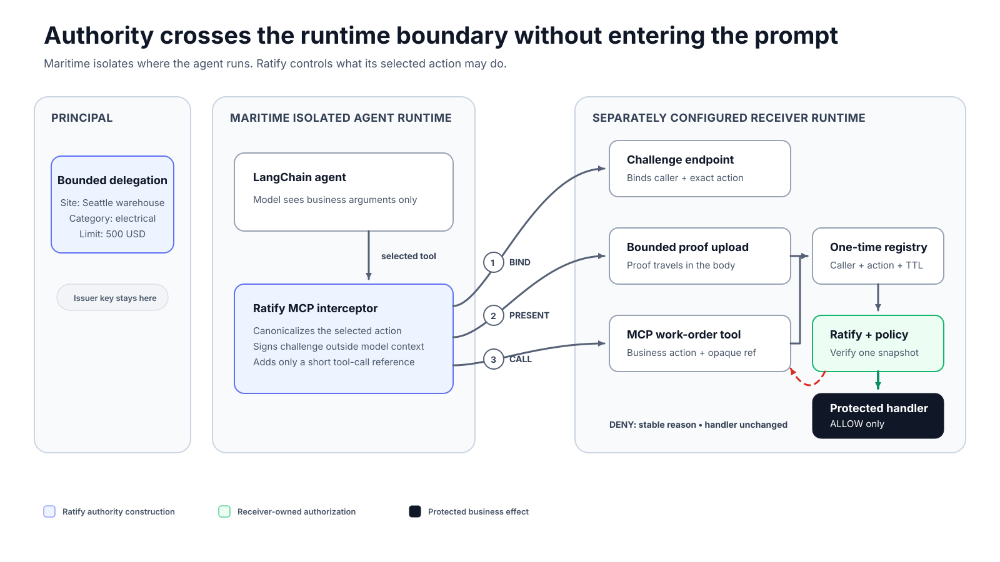
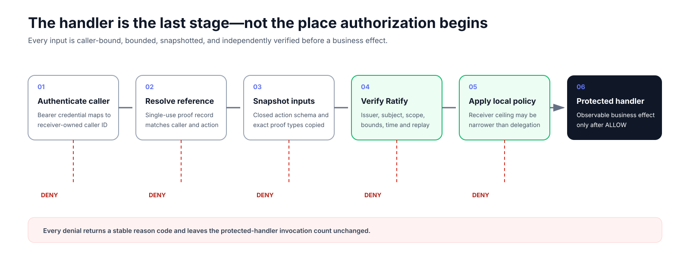

# Ratify Maritime Reference

This is the complete implementation repository for the live
[Maritime × Ratify lab](https://labs.ratifyprotocol.com/maritime). It is not the
shared Labs catalog or a marketing-only demonstration.

The repository contains the LangChain agent, separately deployed MCP receiver,
Ratify authorization boundary, deployment images, issuance tooling, Cloudflare
scenario proxy, public console, adversarial tests, threat model, and deployment
evidence. The separate
[`identities-ai/ratify-labs`](https://github.com/identities-ai/ratify-labs)
repository contains only the shared catalog and closed routing layer.

This open reference implements an authority-aware LangChain agent running on
Maritime and acting through a public MCP tool interceptor against a separately
deployed Ratify-verifying Streamable HTTP MCP receiver.



The frozen Stage 2 receiver core and Stage 3 transport boundary cover exact
allow, signed bounds, receiver-owned time and policy, revocation, replay,
hostile concurrency, caller ownership, strict proof upload, duplicate and
oversized carriers, real Streamable HTTP MCP discovery and execution, and the
LangChain authority-interceptor seam. Stage 4 now includes a deterministic
LangChain agent runtime and an optional production-model configuration; image
verification now passes locally and across two deployed Maritime runtimes; the
public demo console is live at `https://labs.ratifyprotocol.com/maritime`.

Licensed under Apache-2.0. This reference is not a Maritime endorsement or
partnership claim.

## Protocol line

This branch moves the reference to **Ratify Protocol v2** on the published
prerelease `ratify-protocol[protocol-v2]==2.0.0b1`, with the v2 API imported
from `ratify_protocol.v2`. The live deployment at
`labs.ratifyprotocol.com/maritime` still runs the Protocol v1 images
(`ratify-protocol==1.0.0a17`) recorded in [`evidence/`](evidence/); that
evidence is kept unchanged as dated history. No v2 image has been published
and no v2 deployment exists, so the live pilot is not a v2 result.

What v2 changes here:

- the scope stays the exact custom scope `custom:work_order:create`;
- the work-order category is bounded by the standard
  `com.ratifyprotocol.allowed_values/v1` evaluator profile;
- the receiver audience is a `ratify.receiver_audience` constraint, checked
  against the `expected_receiver_id` in every challenge;
- amounts are signed as integer `max_amount_micros`;
- every key ID is the 64-hex v2 key ID, and trust is pinned to complete keys;
- revocation is a list signed by a status key separate from the root key,
  published by the SDK's status publisher; the old environment-variable list
  is gone;
- challenges come from the SDK's issuance helper, and every decision passes
  through a published receipt, the checkpoint acknowledgement, and release
  before the handler can run.

The receiver uses the SDK's in-memory reference stores for the claim store,
receipt log, checkpoint, issuance store and security journal. They are not
durable and the checkpoint shares the receiver's process, so this is a
demonstration verifier, not a production-shaped one. The receiver is a
connected hosted runtime: the SPEC-v2 single-device offline profile does not
apply and is not claimed. The v2 result is the local record
[`evidence/protocol-v2-2026-11-01.md`](evidence/protocol-v2-2026-11-01.md);
see [`docs/THREAT-MODEL.md`](docs/THREAT-MODEL.md) for the limits.



Run the current gate. `uv.lock` pins the published Protocol v2 packages
(`ratify-protocol` and its `ratify-protocol-native-v2` signing backend, both
`2.0.0b1`), which install as wheels:

```bash
uv sync --python 3.12
uv run --python 3.12 pytest
```

The gate requires no model API and includes a real TCP Streamable HTTP flow
through LangChain, the proof interceptor, and the receiver. It executes one
in-bounds allow plus exceeded-limit, wrong-resource, altered-operation,
expired, revoked, replayed, wrong-agent, and copied-certificate denials. See
[`docs/ADVERSARIAL-RESULTS.md`](docs/ADVERSARIAL-RESULTS.md) for the live result
contract and inspectable artifact procedure.

Run every check that has to pass before the pilot is called finished:

```bash
python3 scripts/run_acceptance_gate.py
```

It runs both test suites, the console build and lint, the proxy typecheck, the
deployed-asset check, and the local reproduction, then verifies that the
recorded evidence still carries its own limits and reproduces the deployment it
describes. `--offline` skips the checks that contact the deployment;
`--skip-reproduction` skips the slowest one; `--evidence-only` checks the
recorded evidence with no toolchain required.

After renewing deployment authority, or after any redeploy, add `--live-gates`:

```bash
python3 scripts/run_acceptance_gate.py --live-gates
```

That re-executes both deployed gates against the deployment the committed
evidence describes, using its recorded arguments. It is the check that catches
a renewal mistake, because the tests and the local reproduction both use fresh
material issued on the spot and would not notice one. Its results are written
under `.acceptance/` and never over the published artifacts. On this branch it
refuses to run: the recorded deployment is Protocol v1, and a live v1 result
says nothing about v2 code.

To reproduce the same nine results, plus the five cross-runtime attempts, in
local containers without a Ratify credential or any call to the live
deployment:

```bash
python3 scripts/reproduce_gate_locally.py
```

It needs Docker and Python 3.10 or newer. With
no reviewed v2 image published yet, it builds both images from this checkout,
issues a fresh principal inside the agent image, runs one receiver and two
agent containers on a private Docker network, and checks every result against
[`docs/gate-expectations.json`](docs/gate-expectations.json) and
[`docs/runtime-isolation-expectations.json`](docs/runtime-isolation-expectations.json),
the contracts that the deployed gates and the in-repository tests also read.
`--agent-image` and `--receiver-image` run existing images instead.

Two Maritime runtimes run the same agent image and differ only by injected
authority: one delegated Seattle at five hundred dollars, the other Portland at
two hundred. Neither holds the other's private key. See
[`docs/RUNTIME-ISOLATION.md`](docs/RUNTIME-ISOLATION.md) for what that
demonstrates and how to reproduce it.

## Maritime agent runtime

The root `Dockerfile` is the Maritime GitHub-source build for the agent. It
starts a long-lived server on the injected `PORT` and exposes:

- `GET /health`: side-effect-free readiness
- `POST /chat`: accepts only the nine enumerated adversarial-gate scenarios,
  requires `X-Ratify-Demo-Token: Bearer <RATIFY_DEMO_TOKEN>`, and applies an
  in-process request limit. The dedicated header avoids Maritime's
  platform-level use of `Authorization`.

The default `RATIFY_MODEL_MODE=deterministic` path exercises the real LangChain
and MCP integration without a paid model. Set `RATIFY_MODEL_MODE=production`
and an explicit `RATIFY_MODEL_ID` to use LangChain's OpenAI-compatible
integration. On Maritime, `OPENAI_API_KEY` and `OPENAI_BASE_URL` can be injected
for its metered model proxy; a provider credential is never used for Ratify
proof construction or receiver authorization.

Copy `.env.example` only as a key-name reference. Private agent material and
the receiver token must be configured through Maritime secrets, never committed
or built into an image. Configure `RATIFY_DEMO_TOKEN` as a separate secret for
the public console; it authenticates access to the demo but grants no Ratify
authority.

The agent and receiver images pin their Python base by digest, include only
runtime source, run as an unprivileged user, and expose container health checks.

## Deployment authority issuance

Create deployment material outside the repository on a trusted principal
machine. The command writes separate principal, receiver, agent, and
secret-free manifest artifacts with restrictive permissions:

```bash
uv run --python 3.12 python scripts/issue_demo_authority.py issue \
  /secure/path/maritime-demo-issuance
```

The delegation is valid for seven days. Renew it on day five without changing
the configured root or agent identity:

```bash
uv run --python 3.12 python scripts/issue_demo_authority.py renew \
  /secure/path/maritime-demo-issuance/principal.json \
  /secure/path/maritime-demo-renewal
```

Revocation status is a list signed by the principal's status key, which is
separate from the root key. A signed list is current for at most one day, so
re-sign it at least daily and write the result to the receiver's volume:

```bash
uv run --python 3.12 python scripts/issue_demo_authority.py status \
  /secure/path/maritime-demo-issuance/principal.json \
  /secure/path/maritime-demo-status
```

See [`docs/CREDENTIAL-ROTATION.md`](docs/CREDENTIAL-ROTATION.md).

The generated env files contain authority and credential material, not complete
runtime configuration. Import `receiver.env` only into the receiver, then add
`RATIFY_ALLOWED_HOSTS` after Maritime assigns its hostname, and write
`status-list.json` to the receiver's `/data/ratify/` volume. `receiver.env`
pins the complete root, status and agent public keys and carries the
receiver's own verifier signing key, which signs its receipts. Import `agent.env`
only into the agent, then add the assigned receiver's
`RATIFY_RECEIVER_MCP_URL` and `RATIFY_PRESENTATION_URL`. Maritime injects
`PORT` into both runtimes. `principal.json` must remain outside Maritime and
must never be committed, uploaded, or copied into either runtime. The
delegation and adversarial fixture are written to each runtime's
`/data/ratify/` persistent volume through the Maritime file API. Each runtime
receives the expected SHA-256 digests through environment configuration and
fails closed during startup if the files do not match. Agent signing keys and
transport credentials remain runtime secrets, and the image carries no
authority material. Renewal is therefore a write, digest update, and restart
rather than an image rebuild.

## Proof carrier

The model-visible MCP tool contains only the six business arguments shown in
the architecture. The LangChain interceptor obtains a challenge, uploads the
canonical Ratify proof through a body capped before decoding, receives a short
single-use reference, and adds only that reference to the selected MCP call.
Agent-to-receiver requests authenticate with the dedicated
`X-Ratify-Caller-Token` header because the deployed Maritime gateway removes
the standard `Authorization` header from public runtime requests.

The current hybrid proof is approximately 18 KB. Carrying it directly in an
HTTP header would be brittle across ingress and proxy limits, so this reference
does not do that. The opaque reference is bound to authenticated caller,
Ratify subject, exact canonical action, and a short TTL, and is consumed once.

The frozen build requirements are in
[`docs/REFERENCE-REQUIREMENTS.md`](docs/REFERENCE-REQUIREMENTS.md).

## Demo scenario proxy

`apps/demo-console/worker/` contains the reviewed-before-deployment Cloudflare
Worker boundary for the static console. It accepts only the nine enumerated
scenarios, constructs the Maritime agent request server-side, projects the
response onto documented public fields, and keeps the demo credential in a
Cloudflare secret binding. An exact Durable Object limiter applies both a
per-client and a global budget across Worker instances. No browser credential,
general proxying, evidence API, user account, or analytics store is included.

Deployed pilot topology:

- `apps/agent/`: LangChain agent runtime built by the root `Dockerfile`
- `apps/receiver/`: Ratify-verifying MCP receiver in a second isolated runtime
- `apps/demo-console/`: reviewed proxy followed by a standalone Ratify-branded
  UI published through the shared Ratify Labs catalog at
  `labs.ratifyprotocol.com/maritime`

## Open reference and managed product boundary

This repository uses the open Ratify protocol and local reference components;
it does not require a Ratify service. Ratify Verify is a separate managed
product under development, intended to operationalize functions such as
issuance, trust administration, revocation, and audit without introducing a
proprietary proof format. It is not required to reproduce this pilot.

The pilot is deployed, but it is not yet complete under the frozen reference
criteria. Current-runtime log evidence, Maritime review, publication recording
and screenshots, and the required `ratify-protocol` discovery entries remain
open. The public UI therefore labels this a live pilot rather than a completed
or Maritime-reviewed reference.
